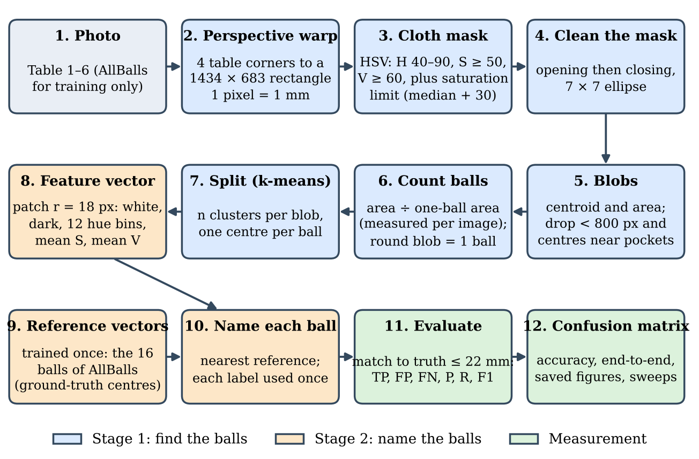

# Pool Ball Detection and Recognition (C++ / OpenCV)

A classical computer vision system that finds the balls on a pool table photo and works out which ball is which (1–15 or white). It was written for a Computer Vision assignment at Trinity College Dublin. No neural networks are used: only perspective correction, colour thresholding, morphology, blob analysis, k-means and nearest-neighbour matching.



## What it does

**Stage 1: find the balls.** The photo is warped to a top-down table view (1 pixel = 1 mm), the green cloth is removed in HSV, the mask is cleaned, and each blob becomes one ball centre. Blobs that hold several touching balls are split with k-means.

**Stage 2: name the balls.** Each centre gets a 16-number colour description (white fraction, dark fraction, 12-bin hue histogram, mean saturation and brightness). It is compared with reference descriptions learned from `AllBalls.jpeg` only, and each label is used at most once per image.

The program also measures itself against the ground truth and saves every figure and table needed for a report.

## Results (Table 1–6, 90 balls)

| Measure | Value |
| --- | --- |
| Stage 1 precision / recall / F1 | 0.922 / 0.922 / 0.922 (83 of 90 found, 7 false positives) |
| Mean position error | 6.9 mm |
| Stage 1 with a strict 11 mm match (IoU 0.5) | precision = recall = 0.778 |
| Stage 2 accuracy (found balls named correctly) | 71.1% (59 of 83) |
| End-to-end (found and named correctly, of all balls) | 65.6% (59 of 90) |
| Solids, 8 ball and white ball named correctly | 91% (41 of 45) |
| Stripes named correctly | 47% (18 of 38) |
| Stage 1 recall without splitting touching balls | 0.456 |

Known weak points: a full rack of touching balls (Table 1), balls touching the cushion, and stripe balls (their appearance depends on orientation). See the report for the analysis.

## Requirements

- Windows, Visual Studio (v143 toolset, Debug x64)
- OpenCV 4.12.0 (prebuilt Windows package, for example extracted to `C:\opencv`)
- The course TIPS lab framework files in this repository (`Utilities.h`, `main.cpp` and the rest). Only `MyApplication.cpp` contains the project code.

## Setup

1. Clone the repository and open the `.sln` file in Visual Studio. Choose **Debug** and **x64**.
2. In the project properties, point the compiler and linker to your OpenCV install. Adjust these paths to match yours:
   - C/C++ > General > Additional Include Directories: `C:\opencv\build\include`
   - Linker > General > Additional Library Directories: `C:\opencv\build\x64\vc16\lib`
   - Linker > Input > Additional Dependencies: `opencv_world4120d.lib`
3. Add `C:\opencv\build\x64\vc16\bin` to your `PATH` (so the OpenCV DLLs are found at run time), then restart Visual Studio.
4. Check that the data is in place:

```
Media/
  Pool/
    AllBalls.jpeg
    Table1.jpeg ... Table6.jpeg
    Ball_Locations_In_Transformed_Image.csv
```

The CSV has one line per image: the image name, then (row, column) for balls 1 to 15 and the white ball. An empty cell means that ball is not on the table.

## Running

Build and run (F5). The program first shows each input image; press a key to move to the next one. It then runs the evaluation and prints the results to the console. At the top of `MyApplication.cpp`, `RUN_SWEEPS` can be set to `false` to skip the parameter sweeps, which take several minutes.

## Output

Everything is written to the `Output/` folder:

| File | Content |
| --- | --- |
| `TableN_1_original.png` ... `TableN_6_labelled.png` | One picture per stage for each table: original, warped, mask before and after cleaning, detections without splitting, detections against ground truth, and predicted labels |
| `per_image_results.csv` | TP, FP, FN, precision, recall, position error and naming accuracy per table |
| `confusion_matrix.csv` | Confusion matrix of the ball names |
| `sweep_*.csv` | Results as one parameter at a time is varied |
| `parameters_used.txt` | Every parameter value used in the run |

## Parameters

All parameters are variables at the top of `MyApplication.cpp` and are the same for every image. The main ones:

| Parameter | Value | Meaning |
| --- | --- | --- |
| Cloth hue / saturation / value | 40–90 / ≥ 50 / ≥ 60 | What counts as green cloth |
| Saturation offset, edge margin | +30, 50 px | Extra rule that finds the dark green balls (6 and 14) |
| Open/close element | 7 px | Mask cleaning |
| Minimum blob area | 800 px | Smaller blobs are noise |
| Pocket radius | 75 px | Detections this close to a pocket are ignored |
| Roundness limit | 85% | A round, ball-sized blob counts as one ball |
| Feature patch radius, hue bins | 18 px, 12 | Colour description of a ball |
| Match distance | 22 mm | Evaluation: one ball radius |

## Project structure

```
MyApplication.cpp   all of the project code (called from main.cpp)
Media/Pool/         input images and ground truth CSV
Output/             created when the program runs
```

## Limitations

- The camera and table corners are fixed; a different camera position needs new corner points.
- The cloth colour range is fixed for this cloth.
- Parameters were fixed while looking at the six test images and there is no separate validation set, so the numbers above are probably slightly optimistic.
- Stage 2 learns from one example per ball.

## Acknowledgements

- [OpenCV](https://opencv.org) 4.12.0.
- The course TIPS lab framework supplied with the assignment, and the assignment images and ground truth.
- Generative AI: this project was developed with help from Claude (Anthropic) for design, code, testing and report drafting. The full details, including the model and the prompts used, are in the separate AI usage declaration submitted with the assignment.
